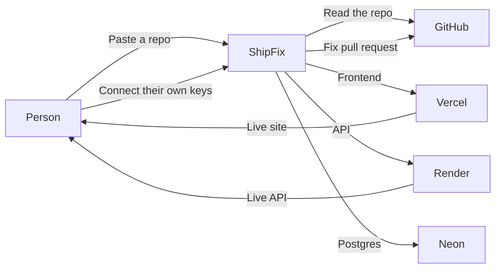
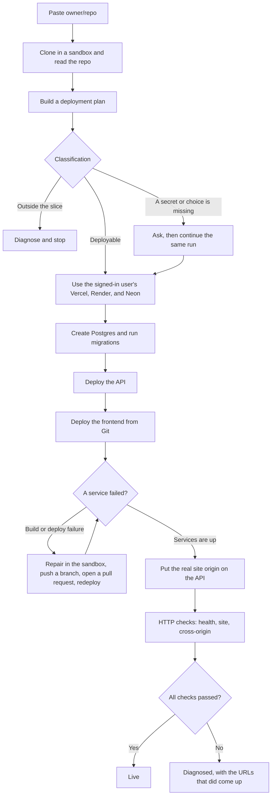
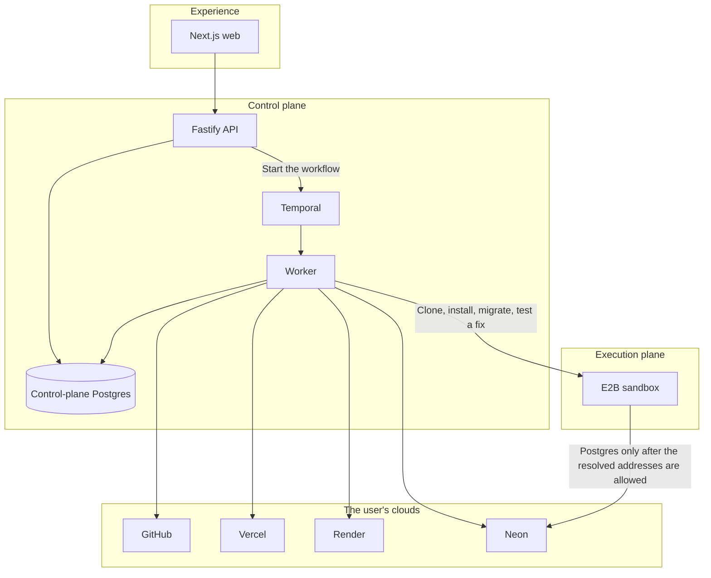
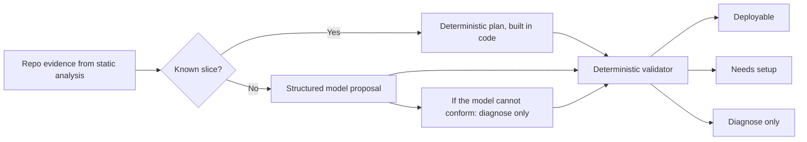
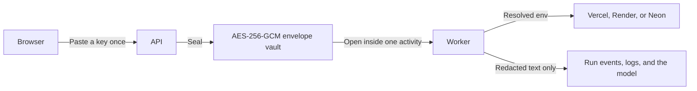
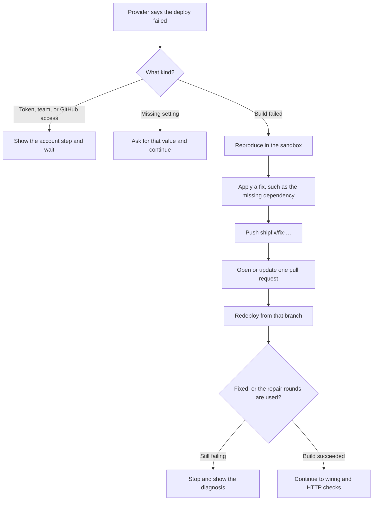
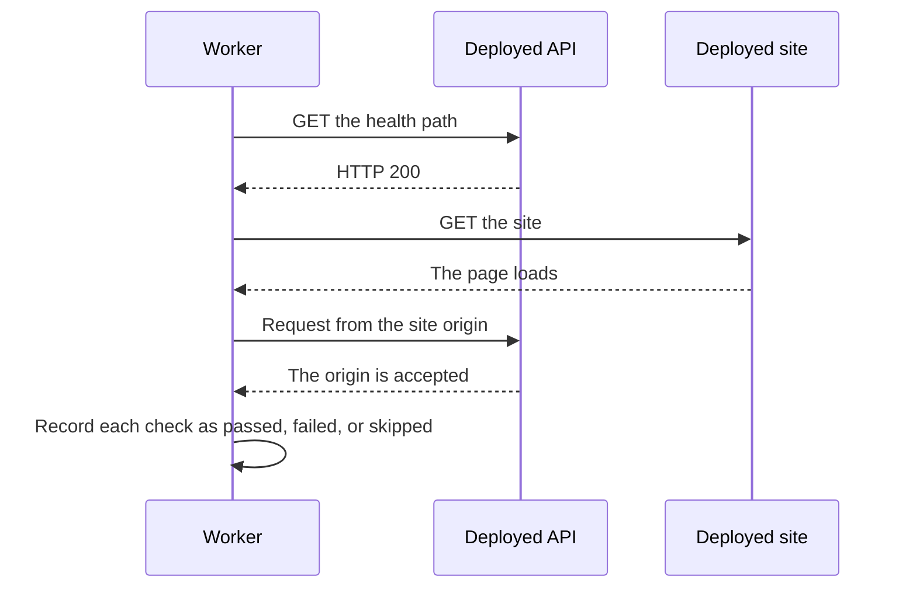

# ShipFix


**Paste your repo link and get it live.**

Your frontend on Vercel ,API on Render and database on Neon.

ShipFix deploys them to the appropriate hosts, wires them, runs the migrations, opens a pull request and fixes problems if the build breaks. The final URL counts only after it answers.

Try it at [shipfix-web.onrender.com](https://shipfix-web.onrender.com).

## What it is for

A person pastes a public GitHub link. ShipFix reads the repo, shows a plan, and asks only for the accounts that plan needs. After those accounts are connected, it creates the database, deploys the services, and reports one of three endings:

| Ending | Meaning |
| --- | --- |
| **Live** | Every check in the plan passed. Health, the site, and the wiring between them. |
| **Diagnosed** | Something useful is up, or the repo is outside the slice ShipFix will deploy. The run says what is blocking and what to do next. No provider is touched for a plan that is not deployable. |
| **Failed** | A deploy was attempted and did not finish. The run names the provider error. A code failure can become a tested fix and a pull request. |

The point of the product is that “deployed” and “live” are different claims. ShipFix only makes the second one after verification.



## The path of one deploy



A plan-only run stops after the plan. An analyze-only run stops after the repo reading. A deploy continues only when the plan is classified **deployable**.

## Four planes

ShipFix is split so that untrusted repository code, secret values, and the model never share a process.



| Plane | What lives there | What must never happen there |
| --- | --- | --- |
| Experience | Sign-in, the plan, the questions, the timeline | Provider tokens, database URLs, model calls |
| Control plane | Auth, run records, the workflow, the vault | Execution of the user's repository |
| Execution plane | Clone, package install, Prisma or Drizzle, the repair attempt | A copy of the vault, or a long-lived host process |
| The user's clouds | The running app | ShipFix's control-plane database |

The API accepts the run and returns. Temporal owns the steps, the retries, and the wait for a person's answer. The worker performs every side effect. A durable Temporal history can resume a run after the worker restarts. The development server keeps that history in a local file, so replacing the process cannot resume a run that was still going.

## How a plan becomes trustworthy

The model is allowed to propose. It is not allowed to decide.



For a Vite or Next frontend, a Node or Python API, and Neon Postgres, the plan is synthesized from the files: scripts, the health route, the env names, the monorepo roots. The same repo produces the same plan whether or not a model is having a bad day. Anything outside that slice may go to the model, and the validator still downgrades a plan that claims a provider ShipFix will not call.

Deployable combinations:

| Where | What |
| --- | --- |
| Vercel | Vite and other static frontends. Next, Nuxt, Remix, React Router, SvelteKit, TanStack Start. |
| Render | Node APIs. Python APIs with a detected run command. A Dockerfile that serves HTTP. One worker when the repo declares one. |
| Neon | Postgres, with Prisma or Drizzle migrations applied by ShipFix. |
| Upstash | Redis, when the repo asks for it. |
| Supabase | An existing project the app already uses. ShipFix reads it. It does not create one. |

Everything else is a diagnosis: Railway, Docker Compose, object storage that would have to be provisioned, a migration tool with no release command. The run explains the blocker and stops before creating resources.

## Secrets



Keys belong to the signed-in user. A deploy spends that user's Vercel, Render, and Neon, not a shared platform token. The worker decrypts a value at the moment a provider call needs it. Events, logs, and model prompts pass through redaction first. A database URL, a GitHub token, and a private key do not appear in the timeline.

Env wiring is by reference, not by guessing names. `generated_from_service` means “the public URL of service X” or “the origin of service X”, read from the resource ShipFix just created. The frontend's API URL waits until the API has a URL. The API's browser origin waits until the site has a URL. Until then the API is given a temporary origin so it can boot, then ShipFix rewrites the real origin and redeploys.

## The repair loop

A failed build is not automatically a code bug, and a code bug is not handed back as a prompt to paste somewhere else.



Each repair tries the change in the sandbox up to three times. The workflow may run that repair twice, then it stops. The pull request uses the ShipFix GitHub App installation that the signed-in user has claimed. That is a different GitHub connection from the one Vercel needs. Vercel deploys from Git, so the Vercel account must have GitHub as a login, and the Vercel GitHub app must be allowed to read the repository. The setup pane says both, with the page where the button is **Configure**.

## Verification

The last stage does not trust the provider's “ready” badge.



A backend-only plan is live when its checks pass. A full-stack plan is live when the API, the site, and the cross-origin check pass. A skipped check is named. A URL that came up while another check failed stays visible, and the run is diagnosed rather than called live.

## Repository

```text
apps/web          Next.js product
apps/api          Fastify control plane
apps/worker       Temporal worker

packages/contracts     The schemas: repo evidence, plan, run events
packages/analyzer      Static reading of a repo
packages/planner       Deterministic plans, then a gated model proposal
packages/validator     The trust boundary on every plan
packages/workflow      The workflow and its activities
packages/sandbox       The only door into untrusted code
packages/secrets       Redaction and the envelope vault
packages/provisioner   Neon, and the other managed resources
packages/autofix      Repair that must be reproducible before a pull request
packages/adapters      One interface, then Vercel and Render
packages/verifier      The HTTP checks
packages/github        The GitHub App: clone, push, pull request
```

Untrusted code crosses `@shipfix/sandbox` and nowhere else. Production uses E2B. The local sandbox runs on the host, refuses to start when `NODE_ENV=production`, and is for development only.

One sandbox detail is easy to miss. The sandbox allowlist matches a domain on the TLS handshake. Postgres sends its startup packet before TLS, so a hostname allowlist drops the connection. ShipFix resolves the database host inside the sandbox and allows those addresses before it runs migrations.

## Develop

Node 20 or newer, pnpm 9.15.4, a Postgres database, and the Temporal CLI.

```bash
corepack enable && corepack prepare pnpm@9.15.4 --activate
pnpm install
pnpm --filter @shipfix/db db:migrate
```

Copy `.env.example` to `.env`. The API, worker, and web dev server read it.

| File | Who reads it |
| --- | --- |
| `.env` | API, worker, and the web dev server |
| `apps/api/.env.local` | API overrides |
| `apps/worker/.env.local` | Worker overrides |
| `apps/web/.env.local` | Web overrides. Only `NEXT_PUBLIC_*` values belong here. |

Auth for a real session is Clerk: `AUTH_MODE=clerk` on the API and `NEXT_PUBLIC_AUTH_MODE=clerk` on the web, plus the publishable key and `CLERK_SECRET_KEY`. `AUTH_MODE=dev` is local only. The API rejects it when `NODE_ENV=production`.

Provider tokens, model keys, `SHIPFIX_ADMIN_TOKEN`, `SHIPFIX_MASTER_KEY`, and database URLs stay off every `NEXT_PUBLIC_*` variable. `SHIPFIX_MASTER_KEY` is a base64 32-byte key (`openssl rand -base64 32`).

Four processes:

```bash
temporal server start-dev     # localhost:7233, UI on :8233
pnpm dev:api                  # http://localhost:4000/health
pnpm dev:worker               # polls the task queue
pnpm dev:web                  # http://localhost:3000
```

In local dev the task queue is scoped to the configured `DATABASE_URL`, so a worker pointed at another database cannot pick up the run. After changing `DATABASE_URL`, restart the API, the worker, the web app, and Temporal together. After changing a model or provider variable, restart the worker. Planning and deploys run there, not in the API.

```bash
pnpm build
pnpm typecheck
pnpm --filter @shipfix/analyzer test
pnpm smoke                    # analyze octocat/Hello-World
pnpm smoke tj/commander.js
```

The long manual deploy checklist is [`docs/e2e-manual-test.md`](docs/e2e-manual-test.md). `GET /admin/config-check` shows whether the API and the worker are on the same database.

Analyze-only success, in order: `queued`, `analyzing`, clone, one `service_detected` per service, env and data detection, `analysis_completed`, `succeeded`. The smoke command prints that timeline and exits 0.

| Failure | What you see |
| --- | --- |
| Not a repo | API `400 missing_repo`. No run is created. |
| Missing or private, with no GitHub App | The run fails on clone. |
| Temporal is down | API `503 workflow_start_failed`. The run is marked failed. |
| Postgres is down | The API refuses to boot, or returns the connection error. |
| The analyzer throws | `analysis_failed`, with the error redacted. |
